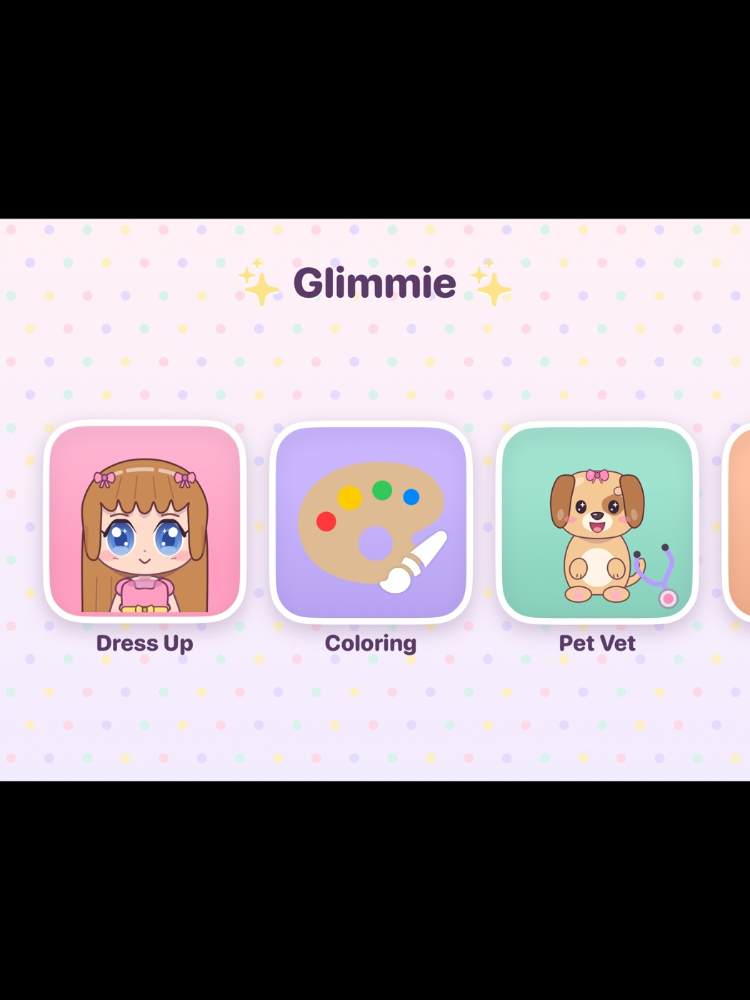
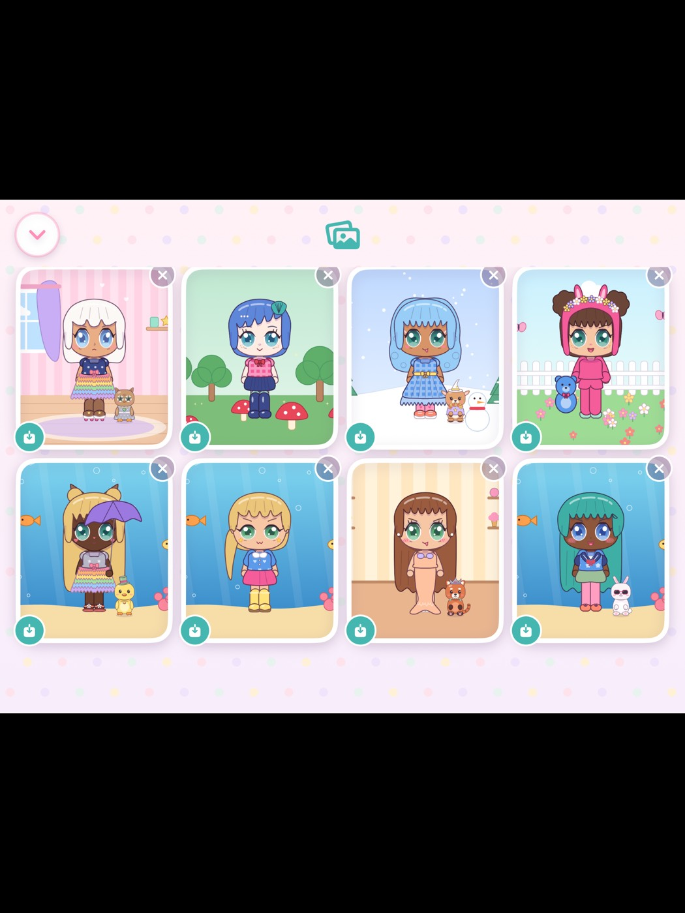
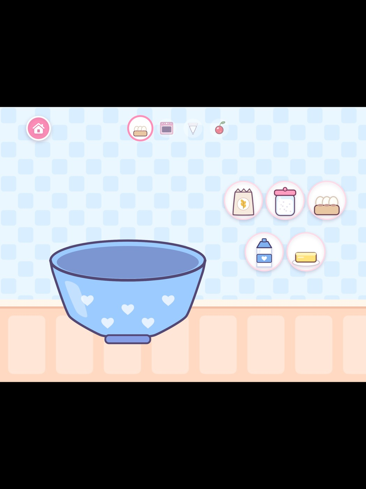
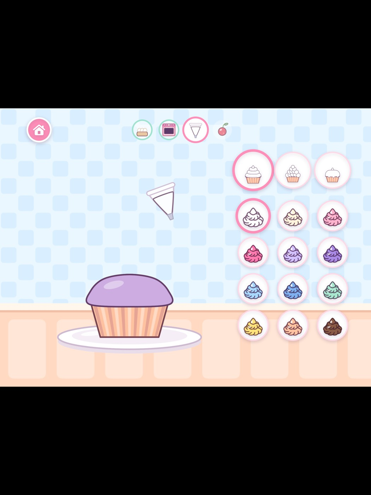

# Glimmie

A drawer of kids' games for iPad (also iPhone, landscape). Every game is complete and free:
**no ads, no purchases, nothing locked.** No robot voice either: the app never uses text-to-speech.

- **Get the app (Feather):** add this source in Feather → Sources → +:
  `https://raw.githubusercontent.com/Rico-Rodriguez/Glimmie/main/source.json`
  Every push to `main` builds a new version, attaches `Glimmie.ipa` to a GitHub Release (`v1.0.<build>`), and updates `source.json`.
- **Or by hand:** grab `Glimmie.ipa` from the latest [Release](https://github.com/Rico-Rodriguez/Glimmie/releases/latest) and import it into Feather, AltStore or Sideloadly.
- **Project notes:** [docs/PROJECT.md](docs/PROJECT.md)

## Games

| Game | What it is |
|---|---|
| **Dress Up** | A chibi doll to dress: 8 skin tones, 5 face shapes, 6 noses, makeup, earrings, 18 back hairstyles × 16 fringes in 18 colors, 12 eyes in 12 colors, brows, mouths, cheeks, 19 dresses, 17 tops, 10 bottoms, 4 coats, 7 socks, 10 shoes, 25 hats and hair pieces, glasses, necklaces, wings, pets and things to hold, in 24 colors and 7 fabric patterns, on 16 scenes. Dice for a surprise look, camera to save it, then a sticker studio to decorate the photo (36 stickers including pets and closet pieces: tap to stick, drag to move, tap to grow, drag to the bin to peel off; 7 frames). Gallery to bring a look back, decorate it again or save it to Photos with its stickers. A pet corner with 20 pets (kitty, puppy, bunny, unicorn, duckling, bear, baby dragon, fox, panda, hamster, red panda, owl, axolotl, piglet, lamb, frog, mouse, koala, penguin, fawn) to name and dress (33 outfits and accessories: hats, glasses, collars, clothes, wings, in 24 colors and 7 patterns). Drag snacks to their mouths (each has a favorite), sponge on bubbles and rinse them off with the shower, towel them dry, brush them until they shine, throw a ball they bop with their heads, tickle them with a feather, pet them, and tuck them into bed. A thought bubble shows what they'd like next. Take one along and it sits at her feet in its outfit. Pet salon: fur dye (8 colors or rainbow), nail polish, glitter and cheek stickers. Mix your own hair, eye and cloth colors in two paint pots (the rainbow paint-palette button at the start of the color row) (blue and yellow really make green). 8 ready-made sets (Halloween, witch, winter, birthday, valentine, beach, princess, spring) dress her, her pet and the scene in one tap, and every piece is in the normal tray too. Tap the music note and she dances, with her pet joining in. Story scenes: pick a scene, bring on her, friends from the gallery and props, drag them about (further back is smaller), and tap someone to make them hop and turn around. Fashion battles: a theme, a rival doll and three animal judges. Tap her and she cheers. |
| Coloring | In progress in its own branch. |
| **Pet Vet** | 16 animal patients (puppy, kitty, bunny, piglet, panda, fox, hamster, lamb, bear, duckling, frog, mouse, koala, penguin, unicorn, fawn) wait with silly problems: mud, thorns, scrapes, a cold, a toothache, bugs, an itchy rash, a tummy ache, a sore foot, leaves in their fur. Drag 20 tools onto them (sponge, shower, tweezers, bandages, thermometer, medicine, toothbrush, ice pack, stethoscope...) and their faces react. Treats, bows, sparkle spray and a tickle feather for pampering. |
| **Bakery** | A sweet shop with 8 animal customers, each ordering one exact treat: a kind, a flavor, a frosting color (or cone) and a topping. The order is a picture card that stays on screen while you bake; each part gets a green tick when it matches, the wanted choices wear a heart, and the customer gives 1 to 3 stars. Bake cakes (1 to 3 tiers) and cupcakes with your own hands: shake the flour bag like a sifter, tip the sugar jar and the milk carton over the bowl until their rings fill, knock the eggs on the rim until they crack open, drop the butter in, and the flavor marbles through the batter as you stir. Hold the bowl to pour a thick ribbon of batter into the pan, watch it rise and turn golden in the oven, then spread the frosting with a spatula (the swooshes stay) or hold to pipe it ring by ring in 3 styles, in 12 colors and 10 cupcake liners. Or build ice cream: 5 cones and cups, 12 flavors, up to 4 scoops, 6 sauces that run down the scoops. Decorate with 37 toppings and 5 kinds of sprinkles in 12 candy colors, then serve it: the customer gobbles it up, hearts fill the jar, and the treat case keeps the last 60. |

| **Pizza** | A pizza kitchen with the bakery's 8 animal customers, each showing the pizza they'd love on a picture card (one or two toppings get a heart and a green tick once they're on). Knead a shaggy dough ball smooth with your hands (each press folds it and puffs flour), flatten it and stretch it out: the edge springs back a little like real dough, and a quick flick up tosses it spinning in the air so it lands bigger and rounder. Ladle sauce on and spread it with the back of the ladle (it really pushes the sauce along and stops at the rim), shake grated cheese over it (each shred falls and lands where it falls), add 8 toppings (pepperoni, mushroom, olive, pepper, pineapple, basil, tomato, ham) by dragging or tapping. Slide it into a wood-fired oven with crackling fire: the cheese melts, flows, bubbles and browns, pepperoni cups and gets glossy, basil wilts and the crust turns golden with charred spots. Roll the pizza wheel across it to cut slices, tap a slice and it lifts out with stretchy cheese strings that snap, and the customer munches it. Every step is open at any time. |
| **Tidy Up** | A cozy put-things-away game in 24 levels: a fridge, bookshelf, cutlery drawer, toy cubbies, bathroom shelf, pencil case, closet, sock drawer, backpack, cupboard, pantry and fruit crate. A moving box tosses 47 kinds of things onto the floor, where they bounce, roll and pile up with real physics. Drag each one to its spot: ghost shapes show where, colored ghosts sort books, crayons, socks and jars by color, and plates, towels, blocks and cans stack from the bottom. Things swing as she carries them, get pulled in when close, and land with a squash, a material-matched click (china clinks, wood toks, plush thuds) and sparkles. Calm music loops (tap the note to turn it off). |
| **Garden** | A glass-fronted garden bed. Dig real holes with the shovel (a flick throws the soil), shake seeds from 8 packets (sunflower, tulip, daisy, lavender, carrot, tomato, strawberry, pumpkin) into them, and water with a can that soaks the soil dark and fills puddles. Plants grow only in damp soil, sway in the wind and spring back from her finger. Tap ripe things into the basket, pull carrots and weeds up by hand. Butterflies, a bee, a ladybug, a worm behind the glass, fireflies. Sun, rain (and a rainbow), wind or night. 8 decorations for the lawn. |

## Your own coloring pages

Drop SVG (or PNG/JPG) files into `art/coloring/mine/<Tab name>/`: each folder becomes a tab in the coloring book.
The build converts them (see [art/coloring/mine/README.md](art/coloring/mine/README.md)).

## Adding a game to the drawer

See `App/Sources/Drawer/GameRegistry.swift`: code in `App/Sources/Games/<Name>/`, files in
`App/Resources/Games/<Name>/`, one `GameEntry`, one line in `GameRegistry.all`.

## Pet Vet art

```
python3 tools/petvet/build.py         # -> App/Resources/Games/PetVet/petvet.json
python3 tools/petvet/make_sounds.py   # -> App/Resources/Games/PetVet/*.wav
```

## Dress Up art

All art is 2D vector, generated by Python into one JSON file the app draws with SwiftUI `Canvas`:

```bash
pip install cairosvg pillow
python3 tools/dressup/build.py          # -> App/Resources/Games/DressUp/dressup.json
python3 tools/dressup/sheet_hair.py /tmp   # contact sheets of the art (also sheet_clothes.py, sheet_extras.py, sheet_bg.py, sheet_pets.py)
python3 tools/make_icon.py              # app icon
```

## Bakery art and sounds

```bash
python3 tools/bakery/build.py    # -> App/Resources/Games/Bakery/bakery.json (pure Python)
python3 tools/bakery/sounds.py   # -> App/Resources/Games/Bakery/*.wav
```
Preview helpers for contact sheets are in `tools/bakery/draw_preview.py` (needs cairosvg).

## Pizza sounds

```bash
python3 tools/pizza/sounds.py   # -> App/Resources/Games/Pizza/*.wav (numpy)
```

## Tidy Up sounds and music

```bash
python3 tools/tidy/sounds.py   # -> App/Resources/Games/Tidy/*.wav and calm.m4a (numpy + ffmpeg)
```

## Screenshots

Run **Build iPad app** manually (Actions → Run workflow) with "Commit simulator screenshots" ticked.

| Drawer | Dress Up | Clothes | Gallery |
|---|---|---|---|
|  |  |  |  |

| Bakery shop | Decorate | Mix | Frost | Ice cream |
|---|---|---|---|---|
|  |  |  |  |  |
