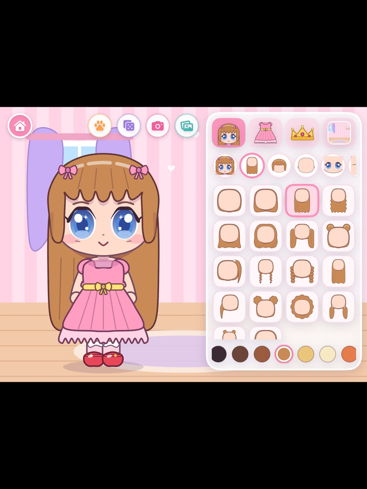
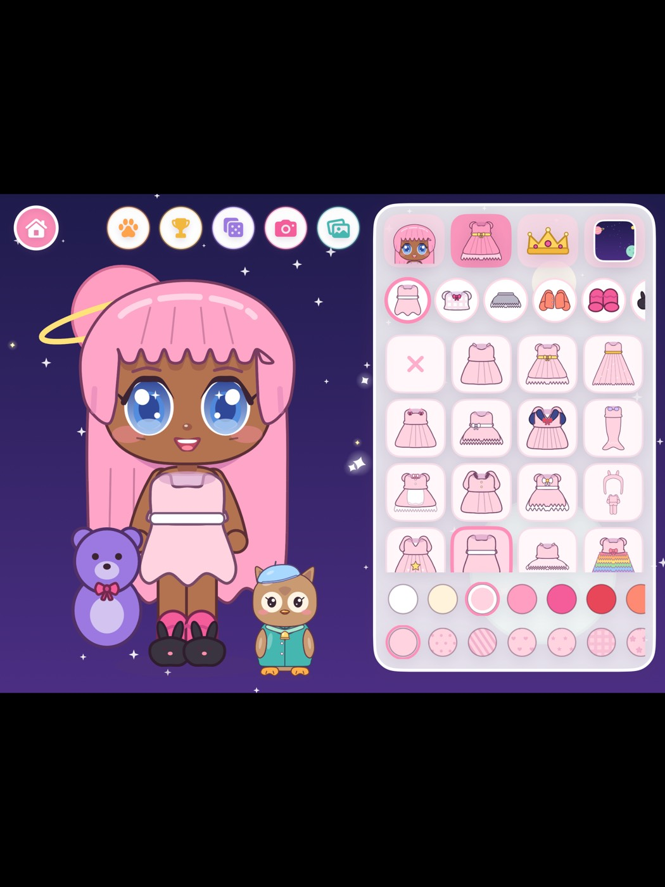
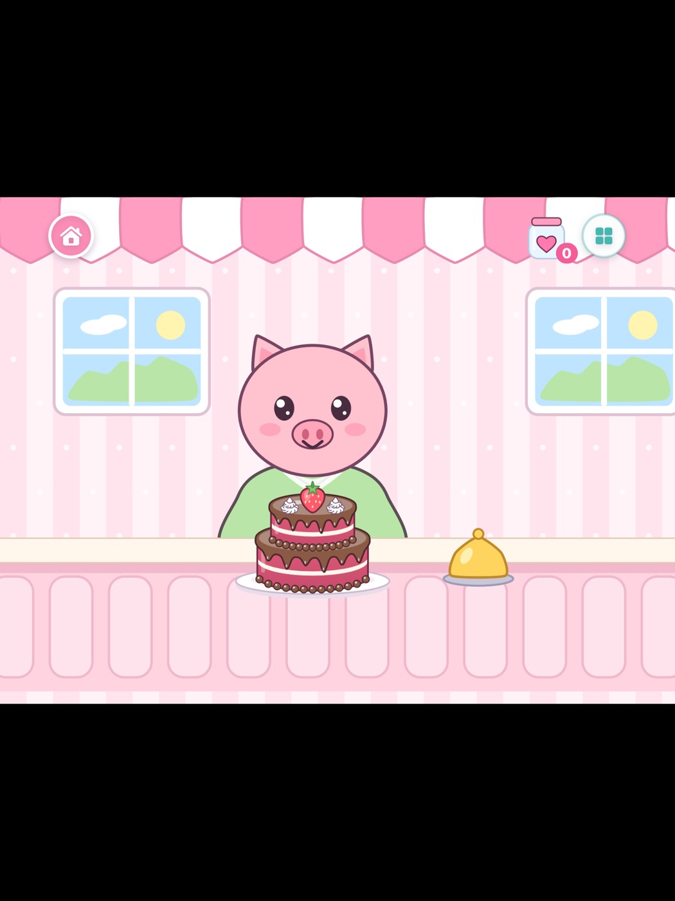
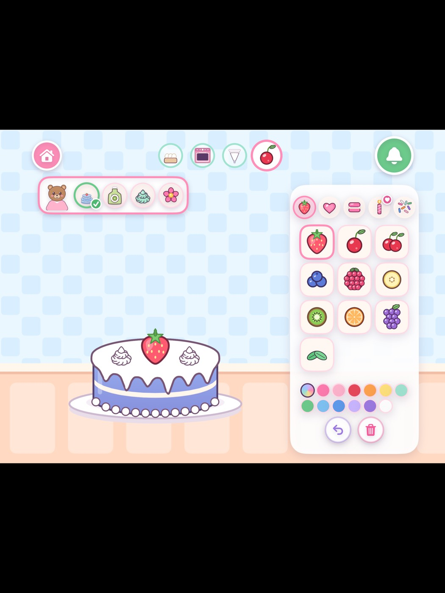
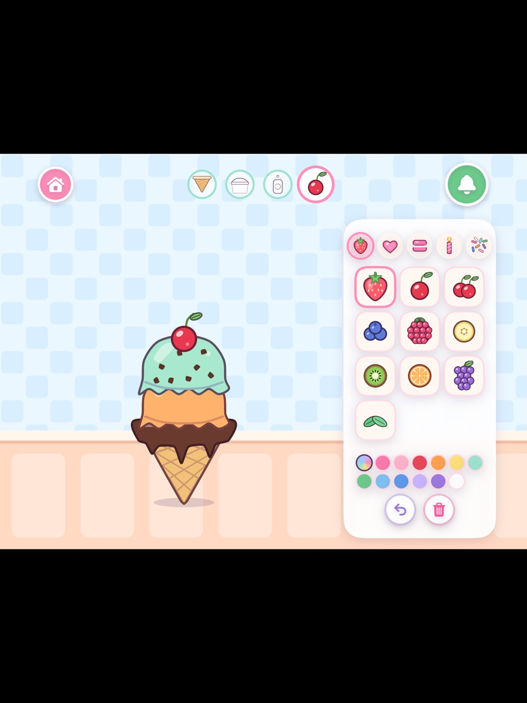

# Glimmie

A drawer of kids' games for iPad (also iPhone, landscape). Every game is complete and free:
**no ads, no purchases, nothing locked.** No robot voice either: the app never uses text-to-speech.

- **Get the app (Feather):** add this source in Feather → Sources → +:
  `https://raw.githubusercontent.com/Rico-Rodriguez/Glimmie/main/source.json`
  Every push to `main` builds a new version, attaches `Glimmie.ipa` to a GitHub Release (`v1.0.<build>`), and updates `source.json`.
- **Or by hand:** grab `Glimmie.ipa` from the latest [Release](https://github.com/Rico-Rodriguez/Glimmie/releases/latest) and import it into Feather, AltStore or Sideloadly.
- **Project notes:** [docs/PROJECT.md](docs/PROJECT.md)

## Games

| Game | What it is |
|---|---|
| **Dress Up** | A chibi doll to dress: 8 skin tones, 5 face shapes, 6 noses, makeup, earrings, 18 back hairstyles × 16 fringes in 18 colors, 12 eyes in 12 colors, brows, mouths, cheeks, 16 dresses, 16 tops, 10 bottoms, 4 coats, 7 socks, 10 shoes, 22 hats and hair pieces, glasses, necklaces, wings, pets and things to hold, in 24 colors and 7 fabric patterns, on 16 scenes. Dice for a surprise look, camera to save it, gallery to bring it back or save it to Photos. A pet corner to name, feed, bathe, brush, play with and tuck in six pets. Fashion battles: a theme, a rival doll and three animal judges. Tap her and she cheers. |
| Coloring | In progress in its own branch. |
| **Pet Vet** | 16 animal patients (puppy, kitty, bunny, piglet, panda, fox, hamster, lamb, bear, duckling, frog, mouse, koala, penguin, unicorn, fawn) wait with silly problems: mud, thorns, scrapes, a cold, a toothache, bugs, an itchy rash, a tummy ache, a sore foot, leaves in their fur. Drag 20 tools onto them (sponge, shower, tweezers, bandages, thermometer, medicine, toothbrush, ice pack, stethoscope...) and their faces react. Treats, bows, sparkle spray and a tickle feather for pampering. |
| **Bakery** | A sweet shop with 8 animal customers who dream of a treat. Bake cakes (1 to 3 tiers) and cupcakes the real way: flour puffs out of the bag, sugar patters in, eggs crack, milk pours, butter plops, and the flavor marbles through the batter as you stir. Hold the bowl to pour a thick ribbon of batter into the pan, watch it rise and turn golden in the oven, then spread the frosting with a spatula (the swooshes stay) or hold to pipe it ring by ring in 3 styles, in 12 colors and 10 cupcake liners. Or build ice cream: 5 cones and cups, 12 flavors, up to 4 scoops, 6 sauces that run down the scoops. Decorate with 37 toppings and 5 kinds of sprinkles in 12 candy colors, then serve it: the customer gobbles it up, hearts fill the jar, and the treat case keeps the last 60. |

## Adding a game to the drawer

See `App/Sources/Drawer/GameRegistry.swift`: code in `App/Sources/Games/<Name>/`, files in
`App/Resources/Games/<Name>/`, one `GameEntry`, one line in `GameRegistry.all`.

## Pet Vet art

```
python3 tools/petvet/build.py         # -> App/Resources/Games/PetVet/petvet.json
python3 tools/petvet/make_sounds.py   # -> App/Resources/Games/PetVet/*.wav
```

## Dress Up art

All art is 2D vector, generated by Python into one JSON file the app draws with SwiftUI `Canvas`:

```bash
pip install cairosvg pillow
python3 tools/dressup/build.py          # -> App/Resources/Games/DressUp/dressup.json
python3 tools/dressup/sheet_hair.py /tmp   # contact sheets of the art (also sheet_clothes.py, sheet_extras.py, sheet_bg.py)
python3 tools/make_icon.py              # app icon
```

## Bakery art and sounds

```bash
python3 tools/bakery/build.py    # -> App/Resources/Games/Bakery/bakery.json (pure Python)
python3 tools/bakery/sounds.py   # -> App/Resources/Games/Bakery/*.wav
```
Preview helpers for contact sheets are in `tools/bakery/draw_preview.py` (needs cairosvg).

## Screenshots

Run **Build iPad app** manually (Actions → Run workflow) with "Commit simulator screenshots" ticked.

| Drawer | Dress Up | Clothes | Gallery |
|---|---|---|---|
|  |  |  |  |

| Bakery shop | Decorate | Mix | Frost | Ice cream |
|---|---|---|---|---|
|  |  |  |  |  |
