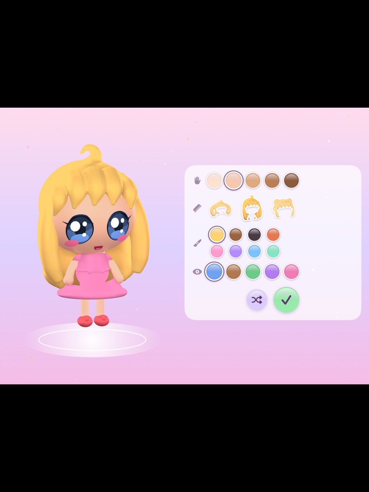
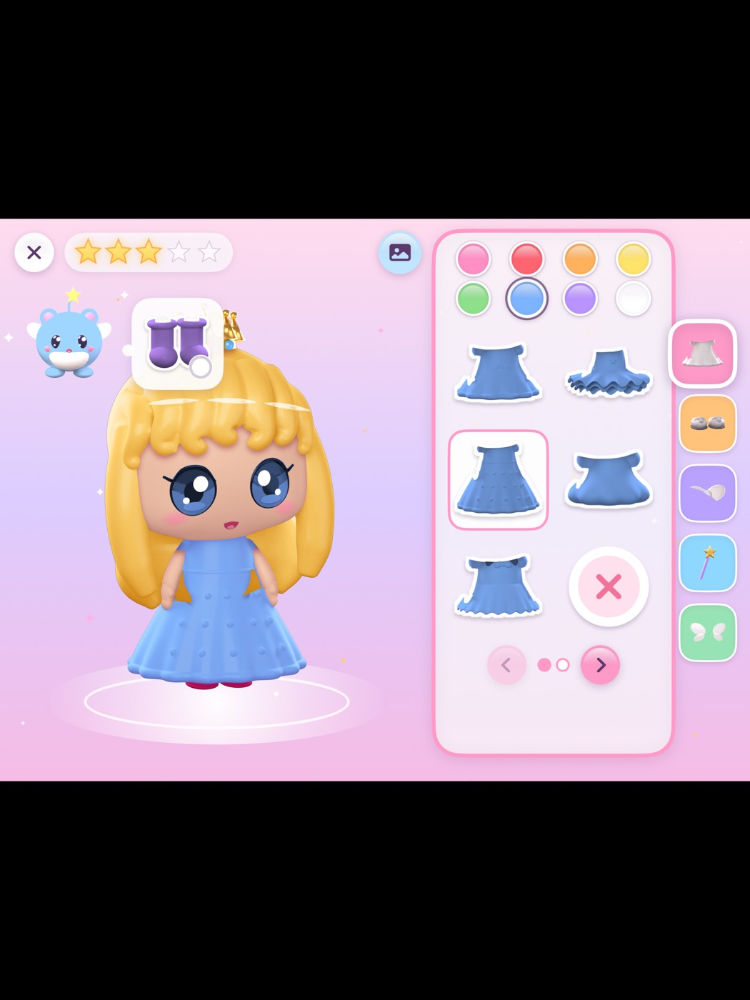
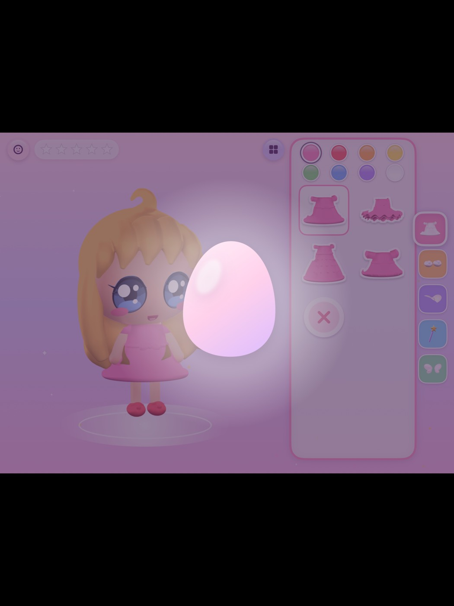

# Glimmie Closet

Dress-up sticker game for iPad, made for a little girl who loves reusable
sticker books and cute magical pets.

- **Status:** v1 Boutique app built (SwiftUI, iPad landscape). GitHub Actions builds an unsigned `Glimmie.ipa` to sideload.
- **Get the app:** open the latest **Build iPad app** run under Actions, download `Glimmie-ipa`, sideload with AltStore or Sideloadly.
- **Project notes, decisions and roadmap:** [docs/PROJECT.md](docs/PROJECT.md)
- **Art pipeline (Blender):** `art/blender/` → `art/renders/` → `tools/process_art.py` → `App/Resources/Art/`

## Re-render the art

```bash
python3 -m venv .bl && .bl/bin/pip install bpy            # Blender as a Python module
SAMPLES=32 .bl/bin/python art/blender/avatar_layers.py -- art/renders ALL
.bl/bin/python art/blender/glimmie_layers.py -- body && .bl/bin/python art/blender/glimmie_layers.py -- face
python3 tools/process_art.py
```

## Screenshots (iPad simulator)

| Avatar maker | Boutique + wish | Magic egg |
|---|---|---|
|  |  |  |

Refresh them by running **Build iPad app** manually (Actions → Run workflow) with "Commit simulator screenshots" ticked.
