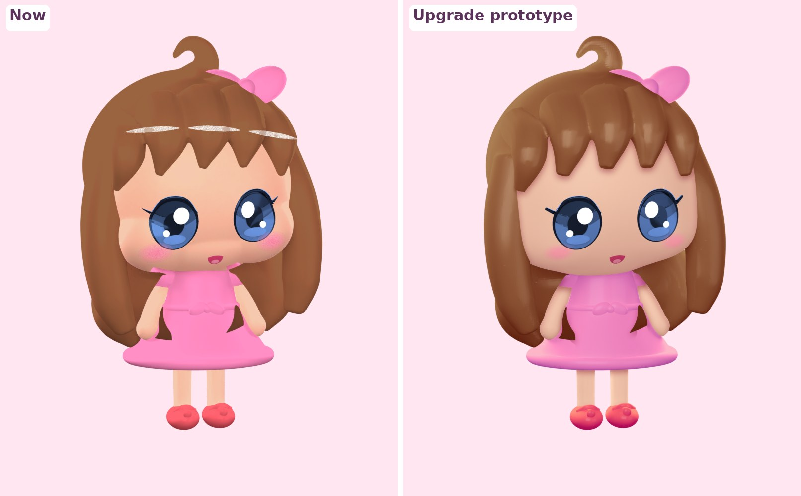
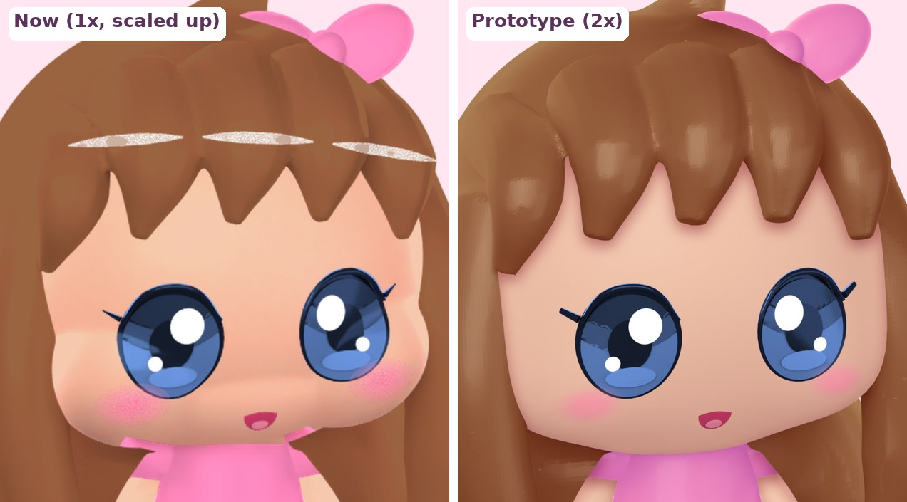
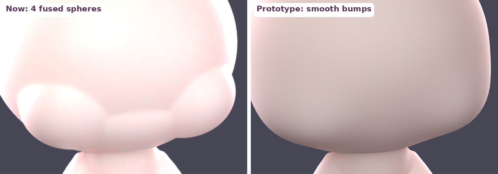
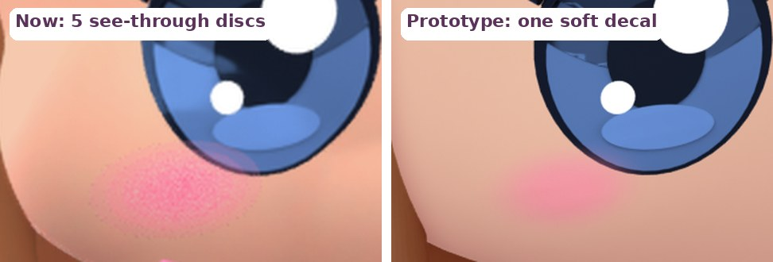

# Better models: the upgrade spec

_Written 2026-11-18 against `main` at `da50941`. `avatar_layers.py` hasn't changed since the art pass in PR #8 (`46e8e32`), and its line numbers point at that. This is the "better models" step of the [roadmap](ROADMAP.md): exact changes to `art/blender/avatar_layers.py`, `tools/process_art.py` and the app, biggest visible change first, each with a check that says when it's done._



_Left: the layers the app ships today, drawn the way `DollView` draws them. Right: the prototype in [`art/blender/experiments/model_v2_proto.py`](../art/blender/experiments/model_v2_proto.py), which applies every change marked **(prototype)** below as patches to today's script, composited by [`tools/compose_layers.py`](../tools/compose_layers.py) with the same operations the app would use. Nothing was painted over._



_The same face up close. Left: today's layers, scaled up as an iPad does. Right: the prototype at 2x, with the bangs' contact shadow on the forehead, the smooth cheeks, the clean blush and the soft lash._

## What PR #8 already fixed

Rounder cheeks, smaller and gentler eyes, a new smile, a softer blush, shine glints on every hairstyle, wings that show past long hair, shoes that peek out under the gown, bunny ears on the head, and 22 new items. This spec starts from there.

## Why the models still look cheap

Measured on the layers in `App/Resources/Art` at `46e8e32`. The first four are in the render pipeline, not the models, so they are the cheapest to fix and they lift every item at once.

| # | Cause | Evidence |
|---|---|---|
| 1 | **The renders are blown out.** On every tintable layer the median brightness is 0.92 to 0.99, and 82% to 100% of the visible pixels are at 0.8 or brighter. The app multiplies a color in, so those areas become one flat color with no shape. | Visible pixels with a channel at 255: skin 80%, sundress 71%, gown 73%, bow 72%, party shoes 51%, long hair 47%, overalls 21% |
| 2 | **Tinted items can't have highlights.** Multiplying never makes a pixel brighter than the tint color, so the coat and specular in the materials (`avatar_layers.py:108-112`) are thrown away. Dresses, shoes and skin read as matte clay. The hair glints are a separate white layer, but they are straight bars laid over the hair rather than light on it. | `DollView.swift:47`, `.colorMultiply(tint)` |
| 3 | **Nothing casts a shadow on anything else.** Each layer renders alone (`show_only`, `:701-705`), so the bangs cast no shadow on the forehead and the skirt none on the legs. Every piece looks pasted on. | Pictures above, left |
| 4 | **The layers are smaller than the screen.** Layers are 800x1000. The doll is drawn 717 pt tall at the 834 pt design height (`BoutiqueView.swift:170`, `GlimmieApp.swift:45`): about 1,430 px on an 11-inch iPad and 1,760 px on a 13-inch one, a 1.4x to 1.8x upscale, so every edge is soft. | Face close-up above |
| 5 | **The cheeks are lumps.** The head is 4 spheres fused together (`:157-160`). Under the face, the skin shows creases below the eyes and notches in the outline. |  |
| 6 | **See-through parts render grainy.** The blush is 5 stacked half-transparent discs (`:248-249`) and the hair glints are half-transparent (`:125-126`). At 40 samples their transparency comes out as speckle. |  |
| 7 | **Some shapes are still primitive.** The bangs are 5 cones that taper to 15% of their width, which makes sharp teeth (`:261-267`). The lash tapers to a point and reads as a spike (`:223`). Hands are spheres (`:153`). Dresses are perfectly round lathed shells with a torus hem (`:330-461`). | |

## The plan

| Step | What | Where | Size |
|---|---|---|---|
| 1 | Render pipeline: exposure headroom, a gloss pass, ramp tinting, contact shadows, 2x size with cropped layers | Blender script, `process_art.py`, `DollView.swift` | M to L |
| 2 | Face: smooth cheeks, `face()` that follows the real head, a soft lash, a clean blush, then let her pick | Blender script | S to M |
| 3 | Hair: soft clump bangs, gloss along the clumps, clumps with grooves, then a ring highlight | Blender script | M |
| 4 | Hands that hold things | Blender script, `DollView.swift` | M |
| 5 | Clothes with folds, gathers and two-tone parts | Blender script | M |
| 6 | The same pipeline for the Glimmie pets | `glimmie_layers.py`, `DollView.swift` | S |

Step 1 changes every layer, so it goes first and lands as its own PR. Steps 2 to 5 are independent of each other after it. Each art PR includes a before and after contact sheet made with `tools/compose_layers.py`.

---

## Step 1: render pipeline

### 1.1 Exposure with headroom (prototype)

For the layers the app tints (skin, hair, clothes, shoes, hats, wings and tintable held items):

| Setting | Now | New |
|---|---|---|
| `sc.view_settings.exposure` (`:683`) | -0.95 | -1.35 |
| Fill light (`:641`) | 150 W, color (1, 0.9, 0.96) | 70 W, color (0.92, 0.94, 1.0): a cooler fill against the warm key |
| Left edge light (`:642`) | 800 W | 450 W: its crescent down the left of the head and hair was most of what still clipped |
| World strength (`:647`) | 0.5 | 0.3 |

Layers the app draws as rendered (eyes, eye shine, face, glints, underwear, gold, flowers) keep today's light and exposure; with the new values they only come out duller. `lighting(new)` in the prototype switches per layer, from the layer's materials. Keep the `Standard` view transform; AgX greys out whites, which breaks tinting.

**Done when:** on every tintable layer at most 5% of the visible pixels have a channel at 255, and the median brightness is between 0.70 and 0.85. The prototype:

| Layer | Clipped now | Clipped in the prototype | Median now | Median in the prototype |
|---|---|---|---|---|
| Skin | 80% | 5.0% | 0.96 | 0.76 |
| Long hair | 47% | 4.6% | 0.94 | 0.75 |
| Sundress | 71% | 4.2% | 0.98 | 0.77 |
| Bow | 72% | 1.1% | 0.98 | 0.78 |
| Party shoes | 51% | 10.4% | 0.95 | 0.74 |

The shoes are the one miss, on the toe tops that face the key light. Try `W_SHOE` at `#EDEBED` and measure again.

### 1.2 A gloss pass for every tintable layer (prototype)

Render each tintable layer twice:

- `L_<name>`, the **base pass**: the tinted materials (`W_SKIN`, `W_HAIR`, `W_CLOTH`, `W_SHOE`, `W_WING`) with `Specular IOR Level` 0 and `Coat Weight` 0, so it holds only the diffuse shading.
- `G_<name>`, the **gloss pass**: the same materials with `Base Color` black, `Subsurface Weight` 0 and `Emission Strength` 0, so it holds only the highlights. In this pass the 3 lights behind the doll (`:642-644`) get `visible_glossy = False` and the world gets `cycles_visibility.glossy = False`. Without that, the edge lights draw a bright outline round every item and the pink sky puts a sheen over everything, which read as a cut-out halo and washed-out color once screened on.

`materials(mode)` in the prototype does this. In the app, `Layer` draws `G_<name>` right above the tinted `L_<name>`: `.colorMultiply(glossTone).blendMode(.screen).opacity(k)`, where `glossTone` is the swatch's light tone (1.3) mixed halfway to white, and `k` is 0.35 for skin, 0.6 for clothes and 0.9 for hair. Untinted layers keep one pass.

**Done when:** skirts, shoes, skin and hair show a highlight in every color, including white and black, and on dark colors it still reads as light rather than a grey smear.

### 1.3 Tint with a ramp instead of multiplying (prototype)

Multiplying darkens a color toward grey in the shadows, which looks muddy. Illustrated and toy styles turn shadows toward violet and lights toward warm. Give every swatch three tones and map the base pass's brightness through them:

| Brightness of `L_` | 0 | 0.45 | 0.86 | 1.0 |
|---|---|---|---|---|
| Tone | shadow x 0.62 | shadow | base | light |

The base stop sits near the 85th percentile of a base pass at the new exposure, so the swatch the player tapped is the color of the lit front of the item, as it is today, and the light tone only reaches the brightest parts.

Starting tones, generated in OKLCH by [`tools/make_ramps.py`](../tools/make_ramps.py): the shadow is 0.20 darker (skin 0.16) with 10% more chroma and its hue turned up to 16 degrees toward violet. The light is 0.06 lighter (skin 0.05, hair 0.07), with a little less chroma, and turned up to 10 degrees toward warm; the gloss pass makes the real highlights, so the light tone stays close to the base. Tune them by eye on a contact sheet, then freeze them in `Model.swift` next to each `Swatch`:

| Group | Swatch | Shadow | Base | Light |
|---|---|---|---|---|
| clothes | pink | `#B450A1` | `#FF8FC4` | `#FDB5C8` |
| clothes | red | `#B60D5A` | `#FF6470` | `#FE8E7F` |
| clothes | orange | `#CB671F` | `#FFB25C` | `#FFCF88` |
| clothes | yellow | `#D39700` | `#FFE36B` | `#FFF4DD` |
| clothes | green | `#13A36A` | `#8EE08A` | `#BCED9A` |
| clothes | blue | `#5B6DC4` | `#7DB4FF` | `#92CBFF` |
| clothes | purple | `#8051C2` | `#B993FF` | `#D6A7FC` |
| clothes | white | `#BBBBD1` | `#FFFFFF` | `#FCFCFC` |
| hair | golden | `#D18819` | `#FFD36E` | `#FEEFCE` |
| hair | brown | `#632512` | `#9A6440` | `#AA7C51` |
| hair | black | `#1D111E` | `#4A3A44` | `#5E4D54` |
| hair | red | `#AB292E` | `#E8774E` | `#F99458` |
| hair | pink | `#B35CAA` | `#FF9AD0` | `#FFC3D6` |
| hair | purple | `#7C48C1` | `#B48CFF` | `#D4A4FE` |
| hair | blue | `#517DC7` | `#79C3FF` | `#9FDBFE` |
| hair | mint | `#09A79A` | `#86E6C4` | `#B4F9D1` |
| skin | peach | `#CFACA1` | `#FFE2D0` | `#FFF3E8` |
| skin | rosy | `#C89283` | `#F6C9AE` | `#FFDDC0` |
| skin | honey | `#B57156` | `#E0A97F` | `#E6BE93` |
| skin | caramel | `#8E4833` | `#B97E57` | `#C39163` |
| skin | cocoa | `#5F291A` | `#8A5A3D` | `#956C48` |

In the app, build the tinted image once per (layer, swatch) with Core Image: unpremultiply, `CIColorMap` with a 256x1 gradient image made from the 4 stops, then put the layer's own alpha back (for example `CIBlendWithAlphaMask` over a clear image, with the original layer as the mask). Cache it in an `NSCache` and draw it instead of `colorMultiply`, keeping `colorMultiply` as the fallback if the filter fails. Eyes keep multiply; their greys were designed for it.

**Done when:** a grey test card through the filter returns the table's tones at the stops, edges show no dark fringe, and changing a color on the stage doesn't stutter.

### 1.4 Contact shadows from each item's outline (prototype)

Every item that sits on the body (5 hairstyles, 9 dresses, 4 shoes, 8 hats, 6 held items) gets an `S_<name>` layer, made by `process_art.py` from the item's own alpha, with no extra Blender pass: the outline moved down 6 px and blurred with a 6 px radius (12 px each at 2x), at 80%, kept only outside the item and where it lands on `skin` or `under`. For hats it may also land on `capproxy`, the cap every hairstyle shares. `contact_shadow()` in `tools/compose_layers.py` is the whole recipe.

In `DollView`, draw each `S_` directly under its own item: `Art.image("S_" + name).renderingMode(.template).foregroundColor(Color(hex: 0xB9788C)).blendMode(.multiply)`, with a `.compositingGroup()` around the doll's `ZStack` so the multiply only sees the doll. The warm mauve keeps shadows from going grey on skin and pastel clothes. The bangs then shade the forehead and the tops of the eyes, the hem shades the thighs, and the hat shades the hair.

Rendered shadows were tried first: Blender shadow catchers on `skin` and `under`, with the item hidden from the camera. They are physically right, but under this key light the skirt darkens the legs all the way down and the long hair darkens the arms and torso, which reads as dirt on a toy. The outline shadow only darkens where things meet.

**Done when:** every hairstyle shows a soft shadow under the bangs on the forehead, the short dresses shadow the thighs just under the hem, and nothing shadows the background.

### 1.5 Render at 2x and crop

- `sc.render.resolution_percentage = 200` (1600x2000). The doll is then never upscaled on any iPad.
- 48 samples with adaptive sampling (`sc.cycles.adaptive_threshold = 0.02`) and the denoiser on; 256 for the layers with see-through parts (face, glints).
- In `process_art.py`, crop every layer (`L_`, `G_` and `S_`) to its alpha bounding box plus 4 px, and write `App/Resources/Art/layers.json` with each layer's rectangle in the 1600x2000 canvas. `Layer` places each crop inside a 0.8 aspect canvas. This is roadmap section 5 item 3; at 2x it stops being optional, because a full 1600x2000 layer decodes to 12.8 MB.
- Clear the color of fully transparent pixels and run `pngquant --quality 85-98` on the `L_` and `I_` files. Gloss and shadow passes are mostly empty and compress well.
- Preload only what the outfit and the open tab use, not every layer (`DollView.swift:23-38`).

**Done when:** a 13-inch iPad simulator screenshot shows no upscaling blur at 1:1, the app's art stays under 25 MB, and decoded image memory with a full outfit stays under 60 MB.

### 1.6 Render time

Measured with the prototype on a 4-core cloud machine (Cycles on CPU, denoiser on). Building the scene takes 15 s. At 1x and 32 samples a layer takes 5 to 13 s. At 2x with 48 adaptive samples: skin 78 s, long hair 61 s, sundress 34 s, and the long hair's gloss pass 40 s.

The full catalogue at 2x is about 90 renders (every layer, plus a gloss pass for each tintable one), so allow about an hour on CPU. That still fits one GitHub Actions job (public repos get 4 cores), which is roadmap section 5 item 5. While iterating, render only the layers whose objects changed. GPU rendering on a Mac (`sc.cycles.device = 'GPU'`) should be much faster, but wasn't measured.

---

## Step 2: face

### 2.1 Smooth cheeks (prototype)

Replace the 4 fused spheres (`:157-160`) with one smooth head whose vertices are pushed out along their normals by soft bumps. Same idea, no creases:

```python
head = obj_sphere((0, 0, HZ), (HX, HY, HZR), seg=128, m=W_SKIN); head.name = 'head'
bpy.ops.object.select_all(action='DESELECT'); head.select_set(True); bpy.context.view_layer.objects.active = head
bpy.ops.object.transform_apply(location=False, rotation=False, scale=True)
BUMPS = (((-0.5, -0.5, -0.52), 0.1, 0.25), ((0.5, -0.5, -0.52), 0.1, 0.25),   # cheeks, under the blush
         ((-0.78, -0.3, -0.5), 0.1, 0.3), ((0.78, -0.3, -0.5), 0.1, 0.3),     # cheeks out: the chubby outline
         ((0.0, -0.48, -0.7), 0.025, 0.25))                                    # chin
# each bump: (center relative to the head, height, width)
n = len(head.data.vertices); co = [0.0] * (3 * n); nr = [0.0] * (3 * n)
head.data.vertices.foreach_get('co', co); head.data.vertices.foreach_get('normal', nr)   # every normal first
for i in range(0, 3 * n, 3):
    x, y, z = co[i:i + 3]
    d = sum(a * math.exp(-((x - c[0]) ** 2 + (y - c[1]) ** 2 + (z - c[2]) ** 2) / (s * s)) for c, a, s in BUMPS)
    co[i:i + 3] = (x + nr[i] * d, y + nr[i + 1] * d, z + nr[i + 2] * d)
head.data.vertices.foreach_set('co', co); head.data.update()
```

Read every normal before moving anything. Setting `v.co` while reading `v.normal` in the same loop makes Blender recompute the normals from the half-moved mesh, and the cheeks crumple like paper; the prototype's first render did exactly that.

**Done when:** the bare skin layer at 2x shows no crease or notch, and the head at the blush line is at least 92% as wide as at the eyes, so the chubby outline stays (today 93%, the prototype 92%).

### 2.2 `face()` follows the real head (prototype)

`face(x, z)` (`:143-145`) assumes the plain ellipsoid, but the lids, the lash, the happy eyes, the bangs and the stars and hearts are placed with it. Redefine it right after the head is built: a ray from `(x, -3, z)` toward +y against the head (`head.ray_cast`, in the head's local space), falling back to the ellipsoid if the ray misses. The lids then sit on the cheeks instead of inside them.

### 2.3 A soft lash (prototype)

`lid()` (`:223`): radius 0.016 with the tip at 75% (now 0.012 tapering to 20%), so the lash reads as a soft flick, not a thorn.

### 2.4 A clean blush (prototype)

One decal that fades out from its center instead of 5 stacked see-through discs (`:248-249`): a Mix Shader between a Transparent BSDF and the blush BSDF, driven by the distance from the decal's center (Generated coordinates and a Map Range from 0.15 to 1.0 with smootherstep, at most 55% opacity). `soft_blush()` in the prototype has the node setup. Render the `face` layer at 256 samples. An even cleaner option is to draw the blush in the app as two radial gradients, which are perfectly smooth at any size and can follow the skin tone.

**Done when:** at 3x zoom the blush shows no speckle and no edge (picture in cause 6).

### 2.5 Let her choose

Render 3 faces (cheek bumps 0.07, 0.10 and 0.13 high; the prototype uses 0.10), show them to her on the iPad, and ship the one she picks.

---

## Step 3: hair

### 3.1 Bangs that end in soft clumps

In `bangs_mass()` (`:261-267`):

- Tips at 26% of the clump's radius instead of 15% (the prototype does only this part; at 34% and up the clumps read as blunt fingers).
- 7 clumps instead of 5, widths from 0.14 to 0.24, neighbours overlapping by about 30%.
- A 4th control point that curls each tip 0.05 to 0.08 toward the middle of the face, so the tips turn in like commas.
- Two thin strands off the main clumps, one per side, so the edge isn't a perfect scallop.

**Done when:** the lower edge of the bangs is a row of rounded clumps with no angle sharper than about 50 degrees.

### 3.2 Gloss along the clumps, then a ring (prototype for the first part)

Give `W_HAIR` anisotropic gloss, so each clump gets a soft streak along its length: a Tangent node (Radial, Z) into the BSDF's Tangent, `Anisotropic` 0.85, `Anisotropic Rotation` 0, `Roughness` 0.3, `Specular IOR Level` 0.6, and `Coat Weight` down from 0.5 to 0.12 so the coat doesn't add round glints on top. `hair_ring()` in the prototype does this; it is the gloss in the pictures above.

A true "angel ring" (one band across the crown and the tops of the bangs) needs more. Anisotropic gloss alone puts its band on the roots of the bangs on this camera, even with an extra light above it, so no ring shows. A shader band does make a ring: an Emission in the gloss pass only, driven by how much the hair faces upward as seen from the camera (Geometry Normal, Vector Transform Normal from World to Camera, Separate XYZ, Y into an Ease color ramp that is white from 0.44 to 0.56 and black outside 0.30 to 0.70, times 1 minus Layer Weight Facing at blend 0.35). `ring_band()` has the nodes, and `--ring 0.5` turns it on. On today's voxel-remeshed hair it also picks up the remesh's small waves as stripes, so do it after 3.3, on cleaner clump surfaces.

When the ring is in, drop the `_shine` glint layers (`:653-677`) and their `Layer` in `DollView`; the prototype already leaves them out.

**Done when:** every hairstyle shows a soft streak on each clump in every hair color, and, once the ring is in, one band across the crown with no stripes at 2x.

### 3.3 Clumps with grooves

The main hair masses are fused with a 0.02 voxel and 14 smoothing passes (for example `:291`), which erases every detail. Build the cap from 10 to 12 clumps that start at a crown whorl and run to the hairline, fused at a 0.014 voxel with 8 passes, so shallow grooves survive. The gloss pass then breaks the highlight along the grooves, as in the reference art.

### 3.4 Then more styles

New styles reuse the clump builder, so they come after 3.1 to 3.3.

---

## Step 4: hands that hold things

- **Hands** (`:153`): replace each sphere with a mitten: a flattened palm `(0.1, 0.06, 0.12)` facing the thigh, a thumb capsule (radius 0.035, length 0.07) at the front pointing forward and down, and a shallow crease between the palm and the finger mass. Fuse at a 0.008 voxel.
- **Holding:** add a `handgrip` layer, tinted with the skin color: the right hand's fingers closed around a 0.03 radius handle at `HAND` (`:578`). `DollView` draws it above the held item whenever the hold slot is filled, and every held item's handle passes through the fist. The wand, balloon string, bouquet, purse, teddy and ice cream are then held instead of floating beside the hand.

**Done when:** at Boutique size the hand reads as a hand (the thumb shows) and every held item is gripped.

---

## Step 5: clothes

- **Folds:** give `lathe()` (`:78-89`) a fold option. After the screw modifier, push each vertex out by `r * (1 + d * t^2 * sin(N * theta + phase))`, where `t` runs from 0 at the waist to 1 at the hem. Start with N = 12, d = 0.05 for the sundress, N = 16, d = 0.035 for the gown, and N = 10, d = 0.06 for the puffy dress.
- **Hems:** sweep the hem trim along the folded hem edge instead of a perfect `torus()`, so the trim follows the folds.
- **Gathers:** 24 small vertical folds just under each waistband, and 6 gathers where each puff sleeve meets the arm, with a thin elastic cuff.
- **Two-tone parts without extra layers:** with ramp tinting (1.3), a part whose base color is about 55% grey lands near the shadow tone. Use it for soles, collars, cuffs and trims, so items get a second tone for free.
- **Cloth sheen:** `Sheen Weight` 0.3 on `W_CLOTH`, for a soft fabric edge.

**Done when:** each lathed dress shows at least 8 folds at the hem, and the hem trim follows them.

---

## Step 6: Glimmie pets

`glimmie_layers.py` gets the same base and gloss split and ramp tinting, plus a soft ground shadow drawn under the pet on the shelf and in Glimmie House.

---

## How to check the result

- **Numbers, in `tools/art_qa.py`** (roadmap section 5): clipped pixels per tintable layer at most 5%, median brightness 0.70 to 0.85, every item at least 60% visible over every hairstyle, every layer aligned to the 1600x2000 canvas, and the head at the blush line at least 92% as wide as at the eyes.
- **A contact sheet in every art PR:** 4 standard looks (all skin tone groups, all hairstyles, every dress at least once) before and after at 2x, plus a face close-up. `tools/compose_layers.py` makes the sheets above.
- **Her verdict:** for the face and the first new outfits, show her 2 or 3 versions and ship the one she picks.

## How the prototype was made

Blender 5.3 as a Python module (`pip install bpy==5.3.0` into a Python 3.13 virtualenv), Cycles on the CPU of a 4-core cloud machine. No Blender app and no GPU.

`model_v2_proto.py` reads `avatar_layers.py`, swaps in the changes as exact-text patches (each patch must match exactly once, so it fails loudly when the script moves), runs it, then renders a base pass (`skin`) or a gloss pass (`G:skin`) for each layer it's given. Then `compose_layers.py` stacks the shipped layers and the new ones in `DollView`'s order:

```bash
python art/blender/experiments/model_v2_proto.py -- out skin under eyes eyeshine face shoes_mary dress_aline \
    hair_long hat_bow capproxy G:skin G:shoes_mary G:dress_aline G:hair_long G:hat_bow
python3 tools/compose_layers.py App/Resources/Art out before-after          # writes before-after.png
```

Add `--scale 2 --border 0.2 0.8 0.35 0.9` to render the head region at 2x for a close-up, and run `compose_layers.py` with `SCALE=2 CROP=190,130,610,600`. `--original` renders exactly what today's script renders.

What was tried and dropped, so nobody repeats it:

- Moving vertices while reading their normals in the same loop: crumpled cheeks (2.1).
- Shadow catchers for contact shadows: dark legs under the skirt and a dark torso under the long hair (1.4).
- The gloss pass with the edge lights and the sky left on: a white halo round every item and washed-out color (1.2).
- The new light and exposure on the eyes and face: dull eyes and a dull blush (1.1).
- Anisotropic gloss or an extra light for the ring: no ring. A narrow shader band: stripes (3.2).
- Bang tips at 34% and 45% of the radius: blunt fingers (3.1).
- A light tone 0.10 to 0.12 lighter than the base, with the base stop at the median: the whole doll looked washed out and the brown hair turned caramel (1.3).
