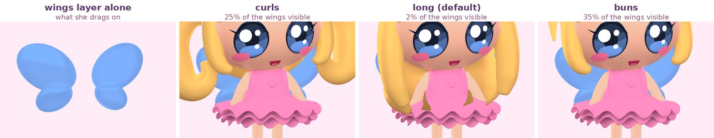
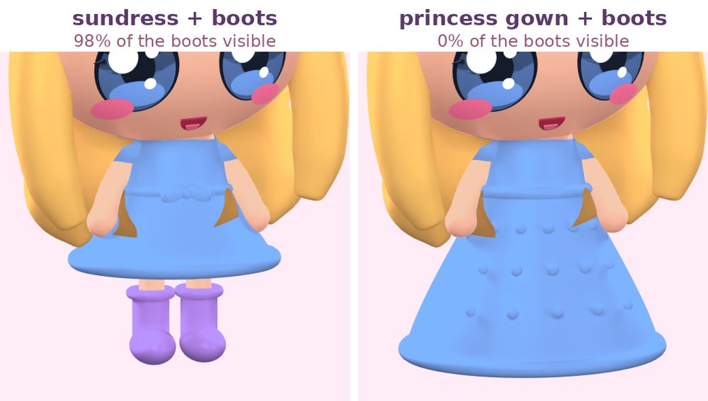
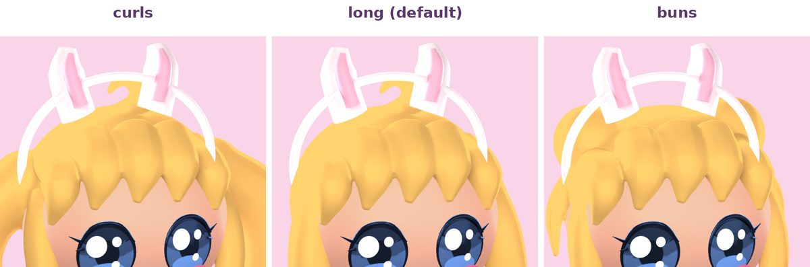
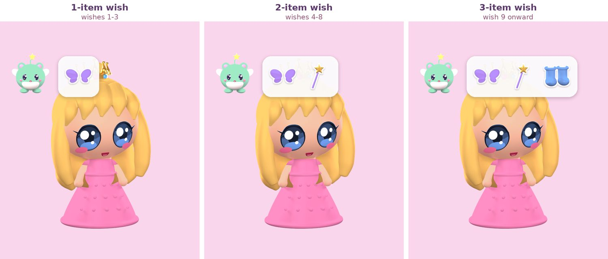

# Glimmie roadmap (after v1)

_Written 2026-11-18 against main at `2e859b3` (release v1.0.17); file and line references point at that commit. It replaces the short "After v1" list in [PROJECT.md](PROJECT.md#34-after-v1). Since then, Glimmie House shipped as the second mode (PR #5), and a separate thread is reworking the models and adding outfits._

_Update, later the same day: the save-data P0 and P1 shipped in PR #7, the art rework with 22 new items in PR #8, and [MODEL_UPGRADE.md](MODEL_UPGRADE.md) is the exact plan for better models, with a tested prototype._

Sizes: **S** is about an hour of work and a quick review, **M** about half a day, **L** several days.

## In one minute

v1 is built, the repo is public, and every push to `main` publishes a new build to the Feather source. Nobody has played it on a real iPad yet. The plan:

1. **This week, put it in her hands.** Set up the iPad (15 minutes, no code) and watch one short session without helping. First impressions only happen once, and none of the known bugs below should stop a first session.
2. **Before the second session, ship v1.1, a safety update.** The most important fix is one she never sees: today, the first update that adds a field to the save data will silently wipe her Glimmies. The rest fixes the egg, stuck stickers, accidental exits and the unguarded reset.
3. **Then fix what she can't see.** Fairy wings are 98% hidden behind the default long hair, the princess gown hides shoes completely, and from the 4th wish on, the wish bubble sits on top of her hat. Each one makes a correct action look broken.
4. **Let her play decide the rest.** The decision table in [0.3](#03-what-session-1-decides) picks the polish. Before adding content, make room for it (the hat tab is already full), then build what she asks for.

| # | Next action | Who | Size |
|---|---|---|---|
| 1 | Install the latest build with Feather and set up the iPad ([0.1](#01-set-up-her-ipad-15-minutes-no-code)) | Rico | 15 min |
| 2 | Playtest session 1 with the observation table ([0.2](#02-playtest-session-1)) | Rico | 20 min |
| 3 | v1.1 safety PR ([section 1](#1-v11-safety-update-before-session-2)) | Claude | S to M |
| 4 | Art fixes for wings, gown and bunny ears, plus an automatic art check ([section 2](#2-v12-make-correct-actions-look-right)) | Claude | M |
| 5 | Sessions 2 and 3 on v1.1, then pick the polish and the first content pack together | Rico and Claude | 1 week |

## Where things stand

| Area | State | How it was checked |
|---|---|---|
| App | v1 complete: avatar maker, Boutique, wishes, star jar, eggs (8 Glimmies), 4 secret looks, sounds, voice, saved progress | Read all of `App/Sources` |
| Device testing | None yet, simulator only | PR #1 |
| Builds | Every push to `main` builds an unsigned `.ipa`, publishes Release `v1.0.<run>` and updates `source.json` | Run 17 published v1.0.17 |
| Feather source | Public: `source.json`, the 3.7 MB `.ipa` and the icon all return HTTP 200. PR #3 fixed a format error that older Feather builds hit | Fetched on Nov 18 |
| Art | 25 avatar layers plus the Glimmie, rendered by `bpy` scripts, fully reproducible | `art/blender/` |
| Content | 16 items in 5 tabs, 3 hairstyles, 8 clothing colors, 8 Glimmies (one body in 8 tints), 4 secret looks | `Model.swift` |

## Principles

- **She is the product manager.** Watch what she reaches for, repeats, ignores and asks for, then build that.
- **Never lose her stuff.** Her collection is the emotional core. Every update must load an old save, and the app must never be deleted to fix a problem.
- **Main ships to her iPad.** Every merge becomes a Feather update, so `main` has to be safe to install at any moment.
- **Two loved modes before a third.** Glimmie House (PR #5) is the second mode. A third waits until playtests show what she wants more of.
- **Public repo, private child.** The repo is public now. Keep her name, photos and detailed play notes out of it, and write learnings here without personal details.

---

## 0. This week: put it in her hands

### 0.1 Set up her iPad (15 minutes, no code)

- [ ] Note the iPad model and iPadOS version (Settings > General > About). Layout, performance and the portrait question below depend on it.
- [ ] Install the latest build from the Feather source. Keep the bundle ID `com.glimmie.closet` when signing, and always install updates over the existing app. Her progress lives only inside the app, so deleting it erases everything.
- [ ] Write down when the signing certificate expires. When it expires or is revoked, the app stops opening until you re-sign and reinstall it. If it was signed with a development certificate and won't open, turn on Developer Mode (Settings > Privacy & Security).
- [ ] Turn on **Guided Access** (Settings > Accessibility > Guided Access), then triple-click the top button (or the Home button) inside Glimmie to lock her in. It stops the home swipe and Control Center from throwing her out, and its options include a time limit.
- [ ] Download a better voice: Settings > Accessibility > Spoken Content > Voices > English, then one **en-US** Enhanced or Premium voice, such as Ava or Zoe. The app picks the best installed en-US voice by itself (`Sound.swift:14-20`) and has no way to choose between several, so install just one.
- [ ] The mute switch won't silence Glimmie, because it uses the `.playback` audio category (`Sound.swift:23`). Use the volume buttons.
- [ ] Hold the iPad upright once. The CI screenshots show the app shrunk to 75% between black bars on an upright iPad. If she sees that too, lock rotation in landscape until there's a portrait layout.

### 0.2 Playtest session 1

**Setup:** 15 to 20 minutes at a calm time of day, on a fresh save. Hand her the iPad with one sentence ("This is a dress-up game, have fun") and don't help for the first 10 minutes unless she gets upset. Sit beside her, not over her. Take notes on paper or your phone, not in this repo.

| Question | What to note |
|---|---|
| Does she discover dragging on her own? | Taps on stickers before her first drag, and the time to her first outfit change |
| Does she notice the wish and understand it? | Does she look at the bubble, listen, and match it? How long do the first 3 wishes take? |
| Does she handle colors in wishes? | Does she use the color dots, or get stuck on a color wish? |
| Does the egg land? | Her face at the hatch, and whether she finds the green check afterwards |
| Does she find the shelf and the face button? | On her own, or never |
| What does she reach for? | Favorite tab, item and color, and any tab she never opens |
| What breaks the flow? | Accidental exits, stuck stickers, "it's not working" moments |
| What does she say? | Her exact words. Requests like "I want a mermaid dress" go straight onto the content list |
| Why does the session end? | Bored, done, interrupted or frustrated |

**The best signal of all:** does she ask to play again the next day without a reminder?

**Already known, so don't spend observation time on them:** wings mostly hidden by long hair, shoes hidden under the gown, the wish bubble covering her hat, rapid taps on the egg doubling the fanfare, and a sticker that can stay stuck in the air after a two-finger drag.

Afterwards, ask two open questions: "What was your favorite part?" and "What should Glimmie have next?" If she likes drawing, ask her to draw a dress she wants in the game. That drawing becomes the first new item.

### 0.3 What session 1 decides

| If you see | Then we |
|---|---|
| 3 or more taps on a sticker before she drags | Add tap-to-wear (a second tap flies the sticker onto her), and keep drag for the sticker-book feel |
| Wishes ignored, or she wanders off mid-wish | Make wishes rarer and easier to skip, and spend the effort on free-play delight (section 3) |
| Wishes taking more than about 2 minutes, or color wishes stalling | Slow the difficulty: at most 2 items until wish 12, colors only on dresses, and a hint after 30 seconds |
| The hatch is the best moment of the session | The end-of-collection cliff ([4.3](#43-after-the-collection-is-full)) becomes the first content priority |
| Lots of color switching and outfit remixing | More items and patterns before more rewards |
| She never finds the shelf or the face button | Picture buttons (a Glimmie face, her own face), see section 2 |
| She plays with the iPad upright | Build a portrait layout |

---

## 1. v1.1 safety update (before session 2)

Small, mostly invisible fixes that make every later update safe. They fit in one or two PRs and don't change how the game plays.

**Done:** the P0 and P1 below shipped in PR #7 (`App/Sources/SaveData.swift`, with 14 tests that run in CI before every release).

| Pri | Problem | Evidence | Fix | Size |
|---|---|---|---|---|
| P0 | **The next save-format change wipes her progress.** Swift's synthesized `Codable` throws when a stored key is missing, `try?` turns that into a blank save, and the next autosave overwrites the old data. Adding a field the usual way (`var musicOn = true`) to `SaveData`, `Avatar` or `Worn` is enough, and Feather would ship it straight to her iPad | `Model.swift:269-279`, `Model.swift:300-301` | Decode every field with a default, add a `version` field, keep the raw old save under a backup key if decoding fails, and add a unit test that loads a v1 save. **Until this lands, don't change `SaveData`** | S |
| P1 | An out-of-range saved index (a palette or hairstyle list that shrinks in an update) crashes the app on every launch | `DollView.swift:62,69,74,80` index the palettes straight from the save | Clamp indices on load (same PR as the P0) | S |
| P1 | Rapid taps on the egg replay the whole hatch: flash, sounds and voice | `RewardsView.swift:101` only checks `hatched`, which turns true 0.55 s after the third tap (`:115`) | Ignore taps after the third | S |
| P1 | The hatch check button may fire twice while the egg fades out, and each call adds the next Glimmie (from reading the code, not seen) | `RewardsView.swift:69`, `BoutiqueView.swift:545-550` | Let it fire once | S |
| P1 | A sticker can stay stuck in the air. SwiftUI doesn't call `onEnded` when a gesture is cancelled, which happens when a second finger switches tabs (`.id(tab)` rebuilds the drawer), on a system swipe, or when the app goes to the background | `BoutiqueView.swift:307,341-345,356-389` | Drive the drag with `@GestureState` and reset it on tab changes and on backgrounding | M |
| P1 | Two fingers on two stickers fight over one shared drag, so the wrong item can go on | One `drag` state serves every sticker's gesture | Accept one drag at a time | S |
| P1 | An edge swipe leaves the app, and the drawer and tabs sit right at the edge | No `defersSystemGestures` anywhere | Add `.defersSystemGestures(on: .all)` so the first swipe stays in the game | S |
| P1 | Holding a faint arrow for 3 seconds wipes everything, with no confirmation | `RewardsView.swift:203-214` | Move reset into the grown-up corner (below), behind a gate and a confirmation | S |
| P2 | After the first celebration, confetti keeps redrawing every frame for the rest of the session | `BoutiqueView.swift:108` never removes it, `Effects.swift:147` | Remove it after 3 seconds | S |
| P2 | A wish can pop up and talk while the shelf or the avatar editor is open | `BoutiqueView.swift:480` only checks `wish` and `showEgg` | Pause wishes while another screen covers the Boutique | S |
| P2 | Closing the app in the half second after the 5th star leaves a full jar and no egg until the next wish | `BoutiqueView.swift:524-536` | Show the egg on launch when the jar is full | S |
| P2 | Art preload runs twice at launch, decoding about 90 MB of images twice | `GlimmieApp.swift:36`, `BoutiqueView.swift:464` | Preload once | S |

**Grown-up corner** (M, same release): a hidden screen behind a gate a pre-reader can't pass, for example a written instruction such as "tap the blue star" that only a reader can follow. It holds:

- the build number, since nothing in the app says which version is installed today,
- sound and voice toggles (and music later),
- reset, with a confirmation,
- the play log below.

**Play log** (M): an on-device event log that never touches the network. It records sessions and minutes, wishes shown and completed with time to complete, taps versus drags on stickers, missed drops, items and colors worn, eggs and secret looks. The grown-up corner shows the totals and can export them, which turns sessions 2 and later into numbers instead of guesses.

**Crash visibility** (S to M): sideloaded builds send crash reports nowhere. Save MetricKit crash reports and a short event trail into the app's Documents folder and turn on Files sharing, so you can send them from Files > On My iPad > Glimmie. Until then, crash logs are under Settings > Privacy & Security > Analytics & Improvements > Analytics Data, in entries that start with "Glimmie".

---

## 2. v1.2: make correct actions look right

These are the places where she does the right thing and the game looks like nothing happened. Each was measured by stacking the app's own layers in `DollView`'s draw order and counting how many of an item's pixels change the final picture.

**Fairy wings are almost invisible.** With the default long hair, 2% of the wings show, with curls 25%, with buns 35%. The wings are about as wide as the body, and the body and hair draw over them. Two of the four secret looks need wings.

**The princess gown hides shoes completely.** A wish for "a princess gown and boots" ticks both boxes while the boots stay invisible.

**The bunny-ear headband floats above the hair** on all three hairstyles. Hats are rendered against one shared cap shape (`avatar_layers.py:277`, `:462-470`), not against each hairstyle.

**From the 4th wish on, the wish bubble sits on top of her hat.** Wishes 1 to 3 ask for 1 item, wishes 4 to 8 for 2, and 9 onward for 3 (`Model.swift:215`). The bubble starts at a fixed spot (`BoutiqueView.swift:170-175`) and grows 120 pt to the right per item, straight over the head. On a 13-inch iPad the 1-item bubble just touches the crown (see `docs/screenshots/3-boutique-wish.jpg`). On an 11-inch iPad even the 1-item bubble covers about two thirds of it. The picture uses the layout numbers from the code for an 11-inch iPad; it is not a device screenshot.

| Fix | Size |
|---|---|
| Re-model the wings bigger and higher so they clear every hairstyle (target: at least 60% visible, checked by the art check in section 5) | M |
| Shorten the gown hem so the shoe toes show, or draw the toes in front of it | S to M |
| Seat headband hats per hairstyle, with one cap shape per hairstyle | M |
| Move the wish bubble off the head, for example a column of icons under the Glimmie along the left edge | S |
| Mark "any color" differently from "this color". Today a want with no color shows the item in its default color (`BoutiqueView.swift:226-230`), so it looks like a color request | S |
| Tapping a wish icon opens that tab and wiggles the right sticker, so a pre-reader can find "something to hold" | S |
| Picture buttons for the shelf and the avatar editor instead of the `square.grid.2x2.fill` and `face.smiling` symbols (`BoutiqueView.swift:97,100`) | S |
| Use "hold" for held items: "Can you wear a sundress and hold a balloon?" | S |

---

## 3. Polish menu (pick from playtest evidence)

Not all of these are worth doing. Choose by what sessions 1 to 3 show; the table in [0.3](#03-what-session-1-decides) points at the likely ones.

| Idea | Why | Size |
|---|---|---|
| She says each item's name as it goes on ("Princess gown!") | Instant feedback and new words, using names already in the catalog | S |
| Items move: wings flutter, the balloon bobs, the wand twinkles | The outfit feels alive, and each layer can be animated on its own | M |
| Gentle background music with a toggle | Today there are sound effects but no music | S to M |
| Peel off: drag an item off her body to remove it | The real sticker-book gesture; the X sticker can stay | M |
| After hatching, pulse the green check and say "Tap the check!" | A pre-reader may not know that the check means continue | S |
| Secret-look hints: after a while, a "?" on the shelf shows one item of its combo | Three-item combos are hard to stumble on | S |
| A softer face (rounder cheeks, eye spacing, softer lids, from PROJECT.md), chosen by her from 2 or 3 renders | "Leans a little creepy" is the oldest art note, and she is the best judge | M |
| A rendered egg with shell pieces | The vector egg is the flattest thing in an otherwise 3D-looking game | M |
| Recorded family voice lines for greetings and praise, with text-to-speech still reading the wishes | Warmer than any synthetic voice | M |
| Arms that actually hold the wand, balloon and bouquet | Held items float beside the hand today | L |

---

## 4. Content: make room first, then build what she asks for

### 4.1 Foundation (before adding more than a handful of items)

- **The drawer can't hold more.** It doesn't scroll (`BoutiqueView.swift:279-297`). On most 11-inch and smaller iPads a tab fits 5 items plus the take-off sticker, and the hat tab already has 5. Add pages with big arrows; scrolling would fight with dragging stickers out. M
- **The shelf is fixed at 8 Glimmies** (`RewardsView.swift:149-152`). Let it page. S
- **A data-driven catalog.** Items, Glimmies and secret looks are written in Swift (`Model.swift:99-123`, `:246-265`). Generate one `catalog.json` from the art pipeline, so a new item is a render plus a line of data with no code change. M
- **Cropped layers** (section 5). Decoded image memory drops from 83 MB to about 10 MB, which matters once the content doubles. M
- **Layering rules for new kinds of items.** One slot per category works today. New kinds need rules decided before anything is rendered: a top and skirt replace a dress and the other way round, socks go under shoes, glasses go over the eyes, a necklace goes over the dress, and a hair clip can share the head with a hat. S

### 4.2 Content packs, in the order she asks

1. **Her ideas.** Whatever she asks for or draws in sessions 1 to 3. One item she invented is worth five we picked.
2. **More hair.** Hair is identity: a ponytail, braids or pigtails, a short bob, and the hair shine band from the PROJECT.md backlog.
3. **A cozy winter pack.** It's November: a puffy coat dress, a beanie or earmuffs, mittens, a snowflake wand, snow boots.
4. **Everyday and pretend.** Pajamas, a swimsuit, ballerina, a mermaid tail, glasses, necklaces.
5. **Distinct Glimmies.** All 8 share one body in 8 tints. Give each one a feature (a bell, leaf ears, a lemon hat, a star tail) as an extra layer, so collecting them feels like meeting new friends.

### 4.3 After the collection is full

Collecting all 8 Glimmies takes 35 wishes (7 eggs of 5 stars, since Rosie comes free). After that, every egg shows the same "you found every Glimmie" screen (`RewardsView.swift:64-67`). If session 1 shows she loves the egg, fix this early:

- **More for Glimmie House.** PR #5 lets her feed, bathe and dress the Glimmies she has hatched; new pet accessories and foods extend that loop without new screens. S to M
- New egg types that hatch a second set of Glimmies, or rare sparkly versions. M
- Rewards that unlock items, for example a secret look unlocking a matching outfit piece. S to M

### 4.4 The next mode (later, one at a time)

Glimmie House is the second mode now. Pick the next one by evidence, not by the list in PROJECT.md. Two candidates build on what exists:

- **Photo booth and lookbook (recommended first, S to M):** snap her outfit with a frame and her Glimmie into an in-app album (SwiftUI's `ImageRenderer`), with "save to Photos" in the grown-up corner. It uses every existing asset and gives her something to show the family.
- **Design Studio lite (M to L):** pick a pattern and colors for a dress, which then becomes a sticker. It's the most magical idea on the list, and patterns can be masked by the existing layer shapes.

The town map, the runway show and the arcade games stay parked until she shows she wants more.

---

## 5. Art pipeline

The scripts in `art/blender/` are reproducible, which is a real strength: any session can re-render everything. Improvements, in order:

1. **Fix the three confirmed art bugs** (wings, gown hem, headbands). M
2. **An automatic art check** (`tools/art_qa.py`): stack every hairstyle with every item, measure how much of each item stays visible, write a contact sheet, and fail when an item is mostly hidden. The images in section 2 came from a prototype of exactly this. Run it whenever `art/` changes. S
3. **Crop layers in `process_art.py`.** Every layer is saved as a full 800x1000 canvas (`process_art.py:13`), even a 165x78 bow. Cropping and storing each layer's offset cuts decoded memory from 82.9 MB to 9.7 MB. Also clear the color of fully transparent pixels: about 59% of them carry leftover color, and clearing it alone shrinks the layer PNGs from 6.6 MB to 1.3 MB. M
4. **One source of truth.** Have the scripts also write the catalog data the app reads: id, category, tintable, default color, draw order and offset. M
5. **Render in CI.** `bpy` installs from pip on Linux, a full render takes about 6 minutes on CPU, and Actions minutes are free on a public repo. A workflow that re-renders when `art/blender/**` changes and attaches the renders plus the art check sheet keeps art changes reviewable. M
6. **Blender MCP, when it's available:** use it for interactive look development, then always land the result as script changes so the art stays reproducible.
7. **Let her art-direct.** For faces and new outfits, render 2 or 3 variants and let her pick.
8. **Better models.** [MODEL_UPGRADE.md](MODEL_UPGRADE.md) has the exact changes: render headroom, a gloss pass, ramp tinting, contact shadows and 2x layers first, then the face, hair, hands and clothes. A prototype of the first steps is in `art/blender/experiments/`, with before and after pictures. It builds on items 2, 3 and 5. L

---

## 6. Distribution and CI

| Pri | Item | Why | Size |
|---|---|---|---|
| P1 | Decide how it's signed | Feather signs with your certificate. A paid Apple Developer account ($99 a year) gives a one-year certificate that nobody else can revoke. Shared certificates can be revoked at any time, and then the app stops opening. Free Apple ID signing (AltStore, SideStore) expires every 7 days | Decision |
| P1 | Show the build number in the grown-up corner | Nothing in the app says which build is installed | S |
| P1 | Skip releases for docs-only pushes | Every push to `main` builds and publishes (`build-ipa.yml:3-7`), so merging this roadmap ships a new version with no app changes. Add `paths-ignore` for `docs/**` and `*.md` | S |
| P2 | Crop the black bars off the screenshots | The simulator stands upright, so the captures are letterboxed portrait images, and that's what Feather shows | S |
| P2 | Move screenshots to their own workflow, run by hand or weekly | The screenshot job takes 3 to 7 minutes and keeps the run open. A second quick merge waits for it, and a third cancels the one waiting | S |
| P2 | Release notes | List the commit subjects since the last release in the GitHub Release, so you know what an update contains before installing it | S |
| P2 | Prune releases beyond the 10 that `source.json` lists | One release per push adds up | S |
| P3 | Make publishing safe to re-run | `gh release create` fails on a re-run because the tag already exists | S |
| P3 | Export her progress to a file from the grown-up corner | Her save lives only inside the app, and an export is the one backup you control | M |
| Later | TestFlight | Needs the paid account and signing secrets in CI, and gives automatic updates with no certificate juggling | M to L |

---

## 7. Engineering hygiene

- **Unit tests in CI** for the model: wish generation never creates an impossible or already-met wish, phrases read correctly ("an orange tutu"), secret looks match, and old saves load. The test target and the CI job exist since PR #7 (save data), so the rest is new files in `Tests/`. S
- **One controller for wishes, stars and eggs.** `BoutiqueView` sequences celebrations with nested `asyncAfter` timers (`BoutiqueView.swift:493-543`), which is where the timing bugs in section 1 come from. Move this into a small state machine with cancellable tasks the next time wishes change. M
- **Future-proof the layout.** iPadOS 26 deprecated `UIRequiresFullScreen` (`project.yml:41`), so a later release may make every app resizable. The layout is built from fixed point sizes, so check it at smaller window sizes before that happens. M
- **No haptics on iPad.** `tapHaptic()` (`Sound.swift:53-55`) does nothing on iPads, so all feedback has to come from sound and motion.

## 8. Not now

A third game mode before the Boutique and the House are loved, an App Store release, accounts or cloud sync, multiplayer or "friend girls", and a Mac build. Each is reasonable later, and none of them helps her this month.

## 9. Decisions for Rico

1. **Which iPad does she use** (model and iPadOS version)? It decides the layout checks and the portrait question.
2. **How does Feather sign it, and when does that certificate expire?** If she'll play most days, a paid developer account is the reliable route.
3. **Text-to-speech or a family voice** for greetings and praise?
4. **Family-only, or the App Store someday?** If someday, a few things change early: the Kids Category rules (parental gates, no third-party analytics), a privacy policy, and signing in CI.

## How this was checked

- Read every file in `App/Sources`, the workflow, the tools and the Blender scripts at `2e859b3`.
- Stacked the shipped layers from `App/Resources/Art` in `DollView`'s draw order with multiply tinting, and measured visibility as the share of an item's pixels that change the final image.
- Computed the Boutique layout for an 11-inch iPad (1180x820 pt) from the sizes in `BoutiqueView.swift`, and checked it against the 13-inch simulator screenshot.
- Fetched `source.json`, the v1.0.17 `.ipa` and the icon from their public URLs (all HTTP 200).
- Not checked: anything on a real iPad. Problems marked "from reading the code" were not seen running.
